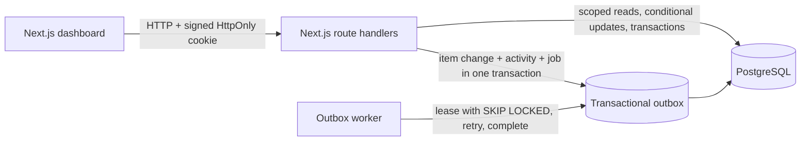

# Fieldnote — Operations under pressure

Fieldnote is a small, team-scoped operations desk for work that should not disappear into chat. It brings ownership, urgency, workflow decisions, handoffs, and an append-only activity trail into one place.

## Run the complete application

Prerequisites: Docker Desktop with Docker Compose and a network connection for the first image build.

From the project folder:

```powershell
docker compose up --build
```

Open [http://localhost:3000](http://localhost:3000). The first start builds the app, waits for PostgreSQL, applies the migration, seeds demo accounts and 1,200 representative work items, then starts the web app and outbox worker. Keep the terminal open; stop the services with `Ctrl+C`.

The demo deployment uses local-only credentials and a local-only signing secret. Do **not** use the values in `docker-compose.yml` for a public deployment. Use a managed PostgreSQL database, a random `JWT_SECRET` with at least 32 characters, HTTPS, and production-specific credentials.

## Demo accounts

Every account has the password `OpsDemo2026!`.

| Role | Email | Access |
| --- | --- | --- |
| Operations lead | `lead@newtonite.demo` | Lead in Operations and Customer Support |
| Operations member | `member@newtonite.demo` | Member in Operations and Customer Support |
| Read-only viewer | `viewer@newtonite.demo` | Read-only in Operations |
| Administrator | `admin@newtonite.demo` | Admin in Operations |
| Finance member | `finance@newtonite.demo` | Member in Finance & Risk; useful for cross-team access checks |

## Local development

Requires Node.js 22+, Docker Compose, and PowerShell. PostgreSQL runs in Docker while Next.js and the worker run locally.

```powershell
Copy-Item .env.example .env
docker compose up -d db
npm ci
npm run db:generate
npm run db:deploy
npm run db:seed
npm run dev
```

In a second terminal, start the asynchronous outbox worker:

```powershell
npm run worker
```

To stop the local database, run `docker compose stop db`. The named Docker volume keeps its data between restarts.

## Run the automated tests

The workflow tests use a real PostgreSQL database. Start the database and ensure `.env` contains the local URL before running:

```powershell
docker compose up -d db
npm ci
npm run db:generate
npm run db:deploy
npm test
npm run typecheck
```

The tests create an isolated team and demo users with unique names, then remove their work items after the suite.

## What is implemented

- A role-aware dashboard with team filters, search, paginated work, and quick views for assigned work, urgent unclaimed items, and lead approvals.
- Item details with comments, searchable context, due dates, ownership, and a timestamped activity trail.
- Server-side access checks for every item read and mutation. Viewer, Member, Lead, and Admin roles are scoped to each team.
- Server-enforced workflow transitions, including a Lead/Admin-only approval decision and closure.
- Atomic claims, optimistic version checks, and idempotent item creation.
- Database transactions that commit the work-item update, activity record, and relevant outbox event together.
- A Postgres-backed worker with row leasing (`SKIP LOCKED`), bounded exponential retries, and a terminal failed state.
- Database indexes for team/status/priority/assignee queues, cursor pagination, activity history, and trigram-backed search.

## Architecture



## Known limitations

- The worker demonstrates reliable outbox delivery and retry semantics, but its notification handler logs events rather than sending email, chat, or push notifications.
- Search is case-insensitive title/description substring matching. Trigram indexes help; language-aware ranking, synonyms, and a dedicated search service are intentionally out of scope.
- Authentication is a seeded-account demo with signed cookies, not SSO, account provisioning, MFA, session revocation, or an organization-wide identity provider. Add rate limiting and operational secret rotation before any public deployment.
- The UI refreshes after each operation instead of using websockets; comments show the latest 100 entries, while activity can be paged back through older events.
- The dataset and deployment are intended for a review/demo, not production availability. There is no backup, monitoring, attachment storage, mobile app, or email delivery.

## Next with another week

Replace demo login with the company's identity provider; add notification delivery and an inbox; add request rate limits and a deployment secret-management guide; add API-level tests for the HTTP boundary and worker crash recovery; and tune queue/search indexes with representative production query plans.
